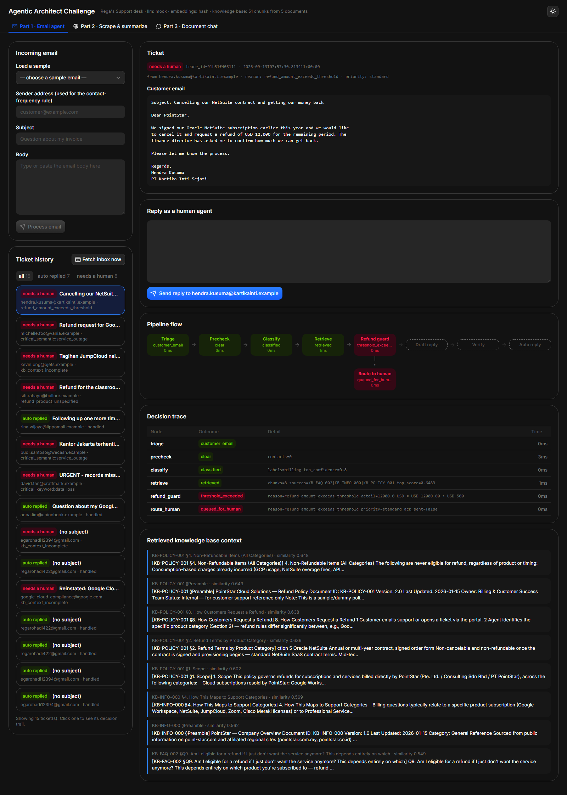
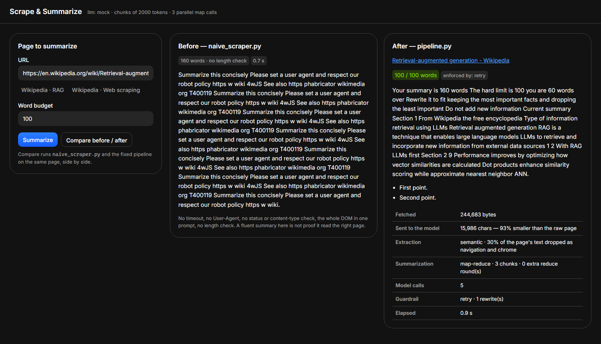
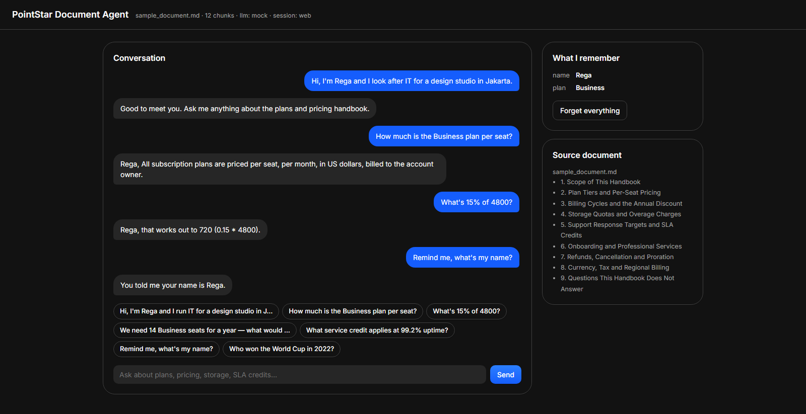

# PANDUAN LENGKAP TRIAGENT

**Dokumen:** Panduan Arsitektur, Fitur, Urutan Eksekusi Kode, dan Analisis Pro-Kontra
**Sistem:** TriAgent (Part 1 Email Agent, Part 2 Scraper, Part 3 Document Agent)
**Basis analisis:** source code pada direktori `D:\TriAgent`
**Bahasa:** Indonesia (istilah teknis dipertahankan dalam bahasa Inggris)

> Dokumen ini menjelaskan apa fungsi setiap berkas dan setiap metode, bagaimana
> ketiganya berjalan dari awal sampai akhir, mengapa sebuah pendekatan dipilih,
> serta kelebihan dan kekurangannya. Semua referensi ditulis dengan format
> `berkas.py:baris` agar mudah ditelusuri.

<!-- pagebreak -->

## Daftar Isi

1. Ringkasan Eksekutif
2. Prinsip Desain Utama
3. Arsitektur Sistem
4. Urutan Menjalankan Kode (Runtime)
5. Core Bersama (Shared Foundation)
6. Part 1 - Email Agent
7. Part 2 - Scraper
8. Part 3 - Document Agent
9. Tampilan UI (Antarmuka Web)
10. Case Demo: Benar vs Salah
11. Infrastruktur, Data, dan Pengujian
12. Referensi Konfigurasi `.env`
13. Matriks Rekapitulasi Pro dan Kontra
14. Catatan Operasional, Risiko, dan Pengembangan

<!-- pagebreak -->

## 1. Ringkasan Eksekutif

Repositori ini berisi tiga sistem AI yang berdiri di atas satu fondasi bersama
(shared foundation) bernama `core/`. Tujuannya adalah menunjukkan pola rekayasa
"agentic" yang aman: model bahasa (LLM) dipakai untuk memahami dan menulis,
tetapi keputusan yang harus selalu benar tidak pernah diserahkan ke LLM.

Ketiga bagian (part) dapat dijalankan terpisah sebagai layanan web:

| Part | Nama | Fungsi utama | Port default |
|---|---|---|---|
| Part 1 | Email Agent | Menjawab email dukungan pelanggan secara otomatis atau mengeskalasi ke manusia | 8000 |
| Part 2 | Scraper | Mengambil halaman web, mengekstrak konten inti, lalu meringkasnya | 8002 |
| Part 3 | Document Agent | Chat tanya-jawab yang terikat pada satu dokumen (handbook) + memori | 8001 |

Fondasi bersama `core/` menyediakan empat hal yang dipakai semua part:

- `core/config.py` - konfigurasi terpusat dari `.env` + path data.
- `core/llm.py` - klien LLM provider-agnostic (DeepSeek, OpenAI, Anthropic, Gemini, dll.) dengan failover antar model/provider.
- `core/embeddings.py` - embedder teks (sentence-transformers atau hashing).
- `core/rag.py` - pemuatan PDF knowledge base, chunking, retrieval, cache.

Poin paling penting dari keseluruhan desain:

> **"Kode memutuskan; LLM mengekstrak dan menulis."** Eskalasi, limit refund,
> dan aritmatika dihitung di Python. LLM tidak pernah menentukan apakah sebuah
> ambang batas terlampaui.

<!-- pagebreak -->

## 2. Prinsip Desain Utama

Bagian ini menjelaskan filosofi yang konsisten muncul di seluruh kode. Memahami
prinsip ini lebih penting daripada menghafal fungsi, karena semua keputusan
arsitektur mengalir darinya.

### 2.1 Pemisahan peran LLM dan kode deterministik

- **LLM untuk persepsi:** klasifikasi kategori, ekstraksi entitas (nominal,
  tanggal, produk), menulis draf, memutuskan tool mana yang dipakai.
- **Kode untuk keputusan:** apakah email harus dieskalasi, apakah nominal
  refund melewati batas, apakah kutipan (citation) valid, apakah aritmatika
  benar.

Alasan: LLM bersifat probabilistik dan bisa "berhalusinasi". Untuk hal yang
memiliki konsekuensi bisnis (uang, keamanan, SLA), hasil harus dapat diaudit
dan diuji. Fungsi seperti `check_refund_thresholds` (part1/entities.py:51)
adalah contoh: angka dibandingkan dengan operator Python biasa, bukan dengan
penalaran model.

### 2.2 Fail-safe / fail-closed

Setiap kali sesuatu tidak pasti, sistem memilih jalur yang paling aman:
eskalasi ke manusia atau berhenti. Contoh:

- `graph.py:_run_node` (part1) menangkap semua exception di dalam node, lalu
  mengubah state menjadi `ROUTE_TO_HUMAN` dengan `route_reason="pipeline_error"`.
- Verifikasi draf yang gagal tidak memaksa kirim; ia meminta redraft sekali,
  lalu eskalasi.
- Scraper menolak URL non-publik (SSRF) alih-alih mencoba.

### 2.3 Idempotensi

Email yang sama tidak boleh dijawab dua kali. `TicketStore.claim_message`
(part1/ticketing.py:206) memakai tabel `processed_messages` dan
`message_attempts` dengan transaksi `BEGIN IMMEDIATE`, sehingga pemrosesan ulang
cukup "claim" sekali. Bila gagal, pesan masuk ke dead-letter setelah beberapa
percobaan.

### 2.4 Observability (keteramatan)

Setiap node mencatat `TraceEvent` (node, outcome, detail, elapsed_ms). Log
memakai `structlog` sehingga bisa dikeluarkan sebagai JSON. `metrics.py`
menghitung auto-resolution rate, latensi p50/p95 per node, dan jumlah redraft.

### 2.5 Dapat dijalankan tanpa API key

Setiap part punya mock LLM (`mock_llm.py`) dan embedder hashing, sehingga
seluruh test berjalan offline. Hal ini membuat pengujian deterministik dan
murah.

<!-- pagebreak -->

## 3. Arsitektur Sistem

### 3.1 Peta direktori

```text
TriAgent/
  core/                     fondasi bersama
    config.py               Settings dari .env + path
    llm.py                  build_llm_client + failover model/provider
    providers/              adapter OpenAI-compatible, Anthropic, registry
    embeddings.py           SentenceTransformerEmbedder / HashingEmbedder
    rag.py                  PDF -> chunk -> embedding -> retrieval + cache
    logging_config.py       structlog (console / JSON)
    spa.py                  shell React bersama + CORS + port tiap layanan
  frontend/                 satu aplikasi React/Vite (Mail, Lens, Docs)
  part1_email_agent/        Mail: agent email berbasis LangGraph
    graph.py                state machine 9 node
    models.py               Pydantic models (state, hasil)
    automated_sender.py     filter email otomatis
    precheck.py             deteksi sinyal kritis (regex + semantik)
    classifier.py           klasifikasi kategori via LLM few-shot
    entities.py             ekstraksi refund + cek ambang batas (kode)
    drafter.py              penulisan draf berbasis konteks
    verifier.py             validasi citation + fact-check
    ticketing.py            SQLite: tiket, kontak, idempotensi, dead-letter
    smtp_sender.py          pengiriman email
    email_loader.py         parsing .eml / IMAP
    poller.py               loop polling IMAP
    fetch_jobs.py           job async untuk fetch manual + progress
    metrics.py              agregasi statistik tiket
    cli.py                  antarmuka baris perintah
    web.py                  FastAPI + API Mail
    mock_llm.py             LLM palsu untuk tes offline
  part2_scraper/            Lens: scraper + peringkas
    naive_scraper.py        versi asli yang cacat (pembanding)
    fetcher.py              HTTP client aman + anti-bot fallback
    extractor.py            ekstraksi konten inti (semantic/density)
    chunker.py              pemecahan teks sadar token
    summarizer.py           map-reduce summarization
    guardrail.py            penegak batas panjang berjenjang
    pipeline.py             orkestrasi fetch -> extract -> chunk -> ringkas
    models.py               model hasil
    web.py                  FastAPI + API Lens
    cli.py                  CLI summarize/compare
    mock_llm.py             peringkas palsu
  part3_doc_agent/          Docs: agent dokumen + memori
    graph.py                state machine route -> retrieve -> calculate -> respond
    router.py               pemilih tool (RouterDecision) + planner aritmatika
    tools.py                kalkulator AST (bukan eval)
    memory.py               memori sesi (window + fakta durable)
    document.py             load markdown -> chunk -> hybrid retrieval
    responder.py            penulis jawaban grounded + citation
    models.py               model state/jawaban
    web.py                  FastAPI + API Docs
    cli.py                  CLI demo/chat/ask
    sample_document.md      dokumen handbook contoh
    mock_llm.py             agent palsu
  knowledge_base/
    markdown/               sumber kebijakan + FAQ (5 dokumen)
    pdf/                    PDF hasil konversi yang dibaca Part 1
    md_to_pdf.py            konverter markdown -> PDF (reportlab)
  data/
    support.db              SQLite (tiket, kontak, idempotensi)
    seed_db.py              pengisi data demo
    sample_emails/          8 email contoh (.eml)
    part3_sessions/         memori sesi Part 3 (JSON)
    index_cache/            cache embedding knowledge base
  scripts/                  kalibrasi threshold + cek SMTP end-to-end
  tests/                    suite pengujian offline
```

### 3.2 Diagram ketergantungan (dependency)

```text
                 +-----------------------------+
                 |            core             |
                 | config  llm  embeddings  rag|
                 +--------------+--------------+
                                |
        +-----------------------+-----------------------+
        |                       |                       |
        v                       v                       v
 part1_email_agent       part2_scraper          part3_doc_agent
 (LangGraph)             (pipeline linear)      (LangGraph)
        |                       |                       |
   SQLite support.db      HTTP + HTML            JSON sesi
   knowledge_base/pdf     (web publik)           sample_document.md
```

Semua part mengimpor `core.config.settings` sebagai satu-satunya sumber
konfigurasi. Tidak ada part yang membaca `.env` langsung (kecuali `core`).

### 3.3 Tanggung jawab tiap modul (ringkas)

| Modul | Tanggung jawab | Tidak boleh |
|---|---|---|
| `core/config.py` | Membaca env, default, path | Mengandung logika bisnis |
| `core/llm.py` | Panggilan LLM terstruktur + failover | Menentukan kebijakan |
| `core/embeddings.py` | Vektor teks | Menyimpan state |
| `core/rag.py` | Index + retrieval | Memanggil LLM |
| Part 1 `graph` | Orkestrasi keputusan | Menulis SQL langsung |
| Part 1 `ticketing` | Persistensi | Memanggil LLM |
| Part 2 `fetcher` | Ambil halaman | Meringkas |
| Part 3 `tools` | Komputasi | Memahami bahasa alami |

<!-- pagebreak -->

## 4. Urutan Menjalankan Kode (Runtime)

Bagian ini menjawab pertanyaan "apa yang terjadi, dalam urutan apa, saat
program dijalankan".

### 4.1 Bootstrap global (semua part)

Urutan inisialisasi yang selalu terjadi:

1. **Import `core.config`** - saat modul pertama diimpor, `PROJECT_ROOT`
   dihitung, `load_dotenv(PROJECT_ROOT / ".env")` dijalankan, lalu objek
   `settings = Settings()` dibuat sekali (config.py:9, config.py:127).
   `Settings` adalah dataclass frozen; nilainya tidak berubah selama proses.
2. **`configure_logging()`** dipanggil dari `lifespan` FastAPI (atau CLI).
   Fungsi ini mengonfigurasi `structlog` (logging_config.py:10).
3. **Pembuatan objek utama** (agent, knowledge base, store) di dalam
   `lifespan` masing-masing `web.py`.
4. **Compile graph** LangGraph (`_build_graph`) untuk Part 1 dan Part 3.

Catatan: `settings.llm_provider` menentukan mode LLM:
- `"deepseek"`, `"openai"`, `"anthropic"`, `"gemini"`, dll. bila API key provider tersebut diisi,
- `"mock"` bila kosong (kecuali `LLM_PROVIDER` di-set eksplisit).

### 4.2 Startup Part 1 (Email Agent)

Berkas `part1_email_agent/web.py`, fungsi `lifespan` (web.py:32):

1. `configure_logging()`.
2. `store = TicketStore()` - membuat/ membuka `data/support.db`, menjalankan
   skema, lalu `_backfill_processed_messages` (ticketing.py:77).
3. **Seed otomatis:** jika `rina.wijaya@lippomall.example` belum pernah
   menghubungi (dalam 3650 hari), jalankan `data/seed_db.py:seed` untuk
   mengisi riwayat kontak demo.
4. `EmailAgent(store=store)` (graph.py:52):
   - Membangun LLM via `build_llm_client(mock_factory=MockLLM)`.
   - `KnowledgeBase.load_or_build()` - membaca PDF di `knowledge_base/pdf`,
     memakai cache di `data/index_cache` bila ada.
   - `CriticalSignalDetector()` - meng-embed anchor regex/semantik.
   - `EmailSender()` - menyiapkan pengirim SMTP.
   - `_build_graph()` - menyusun state machine.
5. Jika `settings.poll_enabled` (IMAP terkonfigurasi + `POLL_ENABLED`),
   `InboxPoller.start()` membuat background task polling.

### 4.3 Siklus satu email di Part 1 (paling penting)

Ketika `EmailAgent.process(incoming)` (graph.py:412) dipanggil:

1. Buat `TicketState` baru dengan `trace_id` unik.
2. `self.graph.invoke(state)` - LangGraph menjalankan node berurutan berikut.
3. Simpan hasil sebagai tiket (`_record_ticket`).
4. Catat kontak (`record_contact`) bila bukan IGNORED.

Urutan node dan percabangannya:

```text
START
  -> triage
     |- email otomatis?  -> IGNORED -> END
     |- lanjut           -> precheck
  -> precheck
     |- sinyal kritis / frequent contact -> ROUTE_TO_HUMAN -> route_human -> END
     |- bersih                            -> classify
  -> classify
     |- confidence < threshold -> ROUTE_TO_HUMAN -> route_human -> END
     |- cukup yakin            -> retrieve
  -> retrieve
     |- tidak ada konteks -> ROUTE_TO_HUMAN -> route_human -> END
     |- ada                -> refund_guard
  -> refund_guard (hanya bila kategori memuat "billing")
     |- melewati batas -> ROUTE_TO_HUMAN -> route_human -> END
     |- dalam batas     -> draft_reply
  -> draft_reply
     |- tidak answerable -> ROUTE_TO_HUMAN -> route_human -> END
     |- ada draf         -> verify
  -> verify
     |- citation invalid / tidak grounded -> (redraft bila attempt <= max) draft_reply
     |                                   -> (habis)                     route_human -> END
     |- grounded                         -> auto_reply -> END
```

Implementasi edge ada di `_build_graph` (graph.py:321). Router `_after`
(graph.py:306) mengembalikan `"route_human"` bila `final_action ==
ROUTE_TO_HUMAN`, selain itu lanjut ke node berikutnya. `_after_verify`
(graph.py:314) menangani loop redraft.

Struktur `process_exactly_once` (graph.py:383):

1. `claim_message(message_id)` - bila gagal (sudah diproses / sedang diproses
   di tempat lain), kembalikan `None` (skip).
2. Panggil `process()`.
3. Bila exception: `release_failed_message` (tandai failed/dead) lalu re-raise.
4. Bila sukses: `mark_message_processed`.

### 4.4 Siklus satu URL di Part 2

Titik masuk: `web.summarize` (part2/web.py:83) atau CLI `summarize`
(cli.py:35). Fungsi inti `pipeline.summarize_url` (pipeline.py:13):

1. `fetcher.fetch(url)` - unduh HTML dengan timeout, batas ukuran, retry, dan
   fallback anti-bot.
2. `extractor.extract(page.html)` - buang script/nav/iklan, pilih kontainer
   konten, normalisasi teks.
3. `summarizer.summarize(llm, content)` - chunk lalu map-reduce.
4. `guardrail.enforce_length(...)` - pastikan panjang sesuai budget.
5. Rakit `PageSummary` berisi statistik (chunk, llm_calls, word_count, dsb).

Sebelum itu, `validate_public_url` (web.py:48) menolak URL yang mengarah ke
alamat privat (SSRF guard).

### 4.5 Siklus satu pesan di Part 3

Titik masuk: `web.chat` (part3/web.py:60). Urutannya:

1. Normalisasi `session_id` untuk nama berkas yang aman.
2. Ambil lock per sesi (`_lock_for`) agar dua request sesi sama tidak balapan.
3. `ConversationMemory.load(session_id)` - muat profil + turn terakhir.
4. `agent.chat(message, memory)` (graph.py:179):
   - Buat `AgentState` dengan `memory_context` sebagai konteks prompt.
   - `graph.invoke(state)`:
     - **route** - `router.route` menghasilkan `RouterDecision`.
     - Jika `needs_document` -> **retrieve** (`document.search`).
     - Jika `needs_calculation` -> **calculate** (`run_tool("calculator")`).
     - **respond** - `responder.respond` menulis jawaban + citation.
   - Simpan fakta baru (`memory.remember`), tambah turn user & agent,
     `memory.save()` ke `data/part3_sessions/<id>.json`.
5. Kembalikan jawaban + jejak (trace) ke klien.

Urutan edge (graph.py:159): `route -> retrieve -> calculate -> respond ->
END`, di mana retrieve dan calculate bersifat kondisional.

### 4.6 Menjalankan lewat CLI, Docker, dan test

Perintah CLI:

```text
python -m part1_email_agent.cli samples          # proses semua email contoh
python -m part1_email_agent.cli process mail.eml # proses satu email
python -m part1_email_agent.cli health           # cek LLM, embedder, KB
python -m part2_scraper.cli summarize <url>      # ringkas satu URL
python -m part2_scraper.cli compare <url>        # banding naive vs fixed
python -m part3_doc_agent.cli demo               # walkthrough skenario
python -m part3_doc_agent.cli chat               # chat interaktif
```

Docker: `docker compose up --build` menyalakan ketiga layanan (lihat
`docker-compose.yml`). Lokal: jalankan `uvicorn` per part seperti tertulis di
`README.md`. Test: `python -m pytest` berjalan offline (mock LLM + hashing
embedder).

<!-- pagebreak -->

## 5. Core Bersama (Shared Foundation)

### 5.1 `core/config.py`

**Tujuan.** Satu sumber kebenaran untuk seluruh konfigurasi dan path data.

**Cara kerja.**

- `PROJECT_ROOT` = dua level di atas berkas ini; `.env` dimuat dari situ.
- Helper `_env_float`, `_env_int`, `_env_bool` mengonversi string env dengan
  default aman.
- `Settings` adalah `@dataclass(frozen=True)`, jadi nilai tidak bisa diubah
  saat runtime. Setiap field memakai `default_factory` agar dibaca saat
  instance dibuat.
- Properti turunan penting:
  - `llm_provider` (config.py) - provider aktif atau `auto`.
  - `llm_backend` - alias lama untuk `llm_provider`; pilih provider atau `mock`.
  - `imap_enabled`, `poll_enabled`, `smtp_enabled` - gerbang fitur.

**Pro.**
- Terpusat, mudah diaudit, env boleh kosong (default masuk).
- Frozen dataclass mencegah perubahan tak sengaja; aman untuk threading.

**Kontra.**
- `settings` adalah singleton tingkat modul, sehingga sulit di-override per
  test tanpa monkeypatch.
- Perubahan env memerlukan restart proses (tidak ada hot reload).

### 5.2 `core/llm.py` dan `core/providers/`

**Tujuan.** Abstraksi panggilan LLM terstruktur (selalu JSON sesuai schema
Pydantic) yang tidak terikat pada satu vendor. Provider dipilih otomatis dari
API key yang diisi di `.env`.

**Komponen.**

- `LLMClient` (Protocol) - kontrak: `name`, `active_model`, dan
  `generate_structured(prompt, schema, system)`.
- `core/providers/openai_compat.py` - adapter untuk DeepSeek, OpenAI, Gemini
  (endpoint OpenAI-compatible), OpenRouter, Groq, Mistral, Together, Fireworks,
  Ollama, LM Studio, dan endpoint OpenAI-compatible lain.
- `core/providers/anthropic.py` - adapter native Claude Messages API; structured
  output memakai forced tool call dengan `input_schema` dari Pydantic.
- `core/providers/registry.py` - preset provider, auto-detect dari env, parsing
  fallback model/provider, dan `build_llm_client`.
- `core/providers/base.py` - retry, failover, schema prompt, pembersihan
  markdown fence, validasi Pydantic, dan klasifikasi error.
- `classify_error(exc)` - memetakan error ke `quota` (429), `balance` (402),
  `auth` (401/403), `unavailable` (400/404/422), atau `transient`.
- `generate_structured`:
  - Menyusun system prompt berisi schema Pydantic.
  - Memilih mode structured output: `json_schema`, `json_object`, atau `prompt`.
    Bila provider menolak mode tersebut, client otomatis menurunkan mode.
  - Memvalidasi hasil dengan `schema.model_validate_json`.
  - Failover antar model dalam satu provider, dan opsional antar provider
    lewat `LLM_FALLBACK_PROVIDERS`.
  - `active_model` dan `name` dicatat untuk observability.

**Pro.**
- Tidak ada vendor lock-in: cukup isi salah satu API key di `.env`.
- Ketahanan tinggi: satu model/provider rate-limited, otomatis pindah.
- Output terstruktur divalidasi Pydantic, bukan hanya mengandalkan JSON mode.
- Temperature 0 membuat hasil lebih deterministik.

**Kontra.**
- Failover menambah latensi bila banyak model/provider bermasalah.
- Cooldown berbasis waktu proses; bila proses restart, status blokir hilang.
- `generate_structured` sinkron (blocking), sehingga di web dibungkus
  `asyncio.to_thread`.
- Fitur provider tidak seragam; schema-in-prompt menjadi fallback universal.

### 5.3 `core/embeddings.py`

**Tujuan.** Mengubah teks menjadi vektor agar bisa dihitung kemiripan
(cosine).

**Dua implementasi.**

- `SentenceTransformerEmbedder` (embeddings.py:20) - model
  `paraphrase-multilingual-MiniLM-L12-v2` (mendukung Indonesia + Inggris),
  `normalize_embeddings=True`.
- `HashingEmbedder` (embeddings.py:31) - vektor 384 dimensi dari hashing
  n-gram karakter (MD5), dinormalisasi. Dipakai saat test offline / tanpa
  model berat.
- `get_embedder` (embeddings.py:52) - cache global (`_cached`) agar model
  hanya dimuat sekali.

**Pro.**
- Embedding semantik membuat pencocokan tahan terhadap parafrase.
- Multilingual penting karena email/klien bisa berbahasa Indonesia atau
  Inggris.
- Hashing embedder membuat sistem benar-benar offline dan cepat.

**Kontra.**
- Sentence-transformers berat (butuh PyTorch, memori besar, lambat saat load
  pertama).
- Hashed n-gram hanya menangkap kemiripan leksikal, bukan makna; akurasi
  retrieval lebih rendah.

### 5.4 `core/rag.py`

**Tujuan.** Membangun knowledge base dari PDF, memecahnya, dan mencari
potongan paling relevan.

**Alur build.**

1. `KnowledgeBase.build` (rag.py:129): untuk setiap `*.pdf`, ekstrak teks
   (`pypdf`), ambil `Document ID` via regex, panggil `chunk_document`, lalu
   embed semua chunk sekaligus.
2. `chunk_document` (rag.py:79) - mendeteksi heading section dengan
   `SECTION_PATTERNS` (pola "1. Judul" atau "Q1. ..."), memecah isi menjadi
   potongan `MAX_CHUNK_CHARS=900` dengan overlap `120` karakter. Setiap chunk
   diberi prefiks `[doc_id §section]`.

**Retrieval.**

- `split_into_subqueries` (rag.py:65) - memecah query menjadi kalimat/paragraf
  bermakna (maks 6), membuang boilerplate sapaan (`BOILERPLATE`).
- `retrieve` (rag.py:150):
  - Encode semua subquery, hitung `embeddings @ query_vecs.T`.
  - Ambil skor terbaik per chunk (`max`).
  - Ambil kandidat `k` teratas dengan skema round-robin antar subquery, lalu
    saring dengan `min_score`.
  - Urutkan ulang berdasar skor.

**Cache.**

- `_fingerprint` (rag.py:188) = hash nama + `mtime_ns` semua PDF + tipe dan
  dimensi embedder. `load_or_build` menyimpan `{key}.json` + `{key}.npy`.

**Pro.**
- Multi-subquery membuat email dengan beberapa pertanyaan sekaligus tetap
  terlayani.
- Cache berbasis fingerprint mencegah re-embedding saat PDF tidak berubah.
- Chunk memiliki label sitasi sehingga bisa dirujuk balik.

**Kontra.**
- Pemotongan karakter (bukan token nyata) bisa memotong di tengah kalimat.
- Tidak ada re-ranking (cross-encoder); retrieval murni vektor.
- Ekstraksi PDF bergantung kualitas teks PDF; PDF hasil scan akan gagal.

### 5.5 `core/logging_config.py`

**Tujuan.** Logging terstruktur lewat `structlog`.

**Cara kerja.** `configure_logging` (logging_config.py:10) menyalakan ulang
encoding stdout/stderr ke UTF-8, mengonfigurasi `logging.basicConfig`, lalu
memasang processor: `merge_contextvars`, `add_log_level`, `TimeStamper`, dan
renderer (JSON bila `--log-json`, selain itu console). `bound_contextvars`
dipakai untuk menempel `trace_id` pada semua log satu pemrosesan email.

**Pro.** Log terstruktur mudah di-query; `trace_id` memudahkan pelacakan
end-to-end. **Kontra.** Tidak menulis ke berkas secara default (hanya
stdout), sehingga perlu agregator eksternal untuk produksi.

<!-- pagebreak -->

## 6. Part 1 - Email Agent

### 6.1 Ringkasan alur

Email masuk -> disaring (triage) -> deteksi kritis (precheck) -> klasifikasi ->
ambil konteks KB (retrieve) -> cek refund (refund_guard) -> tulis draf ->
verifikasi -> balas otomatis atau eskalasi. Semua hasil disimpan sebagai tiket.

### 6.2 `models.py` - struktur data

| Model | Isi | Catatan |
|---|---|---|
| `Category` | billing, technical, feedback, account, general | kategori tetap |
| `FinalAction` | auto_reply, route_to_human, ignored | tindakan akhir |
| `Priority` | critical, standard | prioritas tiket |
| `CategoryScore` | category, confidence, reason | satu label |
| `ClassificationResult` | list label | properti `top_confidence`, `category_names` |
| `RefundEntities` | mentions_refund, amount, currency, purchase_date, product | hasil ekstraksi |
| `DraftResponse` | text, citations, fully_answerable | draf balasan |
| `VerificationResult` | fully_grounded, unsupported_claims | hasil fact-check |
| `TraceEvent` | node, outcome, detail, elapsed_ms, at | jejak audit |
| `IncomingEmail` | sender, subject, body, message_id, headers | input |
| `RetrievedChunkView` | text, doc_id, section, score | konteks |
| `TicketState` | seluruh state pipeline | `trace` memakai `operator.add` agar akumulatif |

**Pro.** Pydantic memvalidasi tipe dan rentang (mis. `confidence` 0..1 pada
models.py:28). **Kontra.** State besar disimpan sebagai satu dokumen saat
`invoke`, menambah salinan memori.

### 6.3 `automated_sender.py` - triage

**Fungsi `check(sender, headers, own_addresses)`** (automated_sender.py:22).

- Tujuan: mencegah bot loop (sistem membalas email yang ternyata auto-reply).
- Deteksi berurutan: alamat sendiri -> header `Auto-Submitted` -> `Precedence`
  (bulk/list/junk/auto_reply) -> header milis (`list-id` dll) -> pola
  local-part `no-reply`, `mailer-daemon`, `postmaster`, dsb.
- Output: `AutomatedCheck(is_automated, reason, evidence)`.

**Pro.** Sangat cepat, tanpa biaya LLM, dan menangkap mayoritas auto-reply.
**Kontra.** Berbasis pola tetap; pola baru perlu ditambah manual.

### 6.4 `precheck.py` - deteksi sinyal kritis

**Tujuan.** Menangkap kasus darurat (kehilangan data, gangguan layanan,
pelanggaran keamanan) sebelum LLM dipanggil, serta mendeteksi pelanggan yang
terlalu sering menghubungi.

**Metode (dua lapis):**

1. **Regex `match_keywords`** (precheck.py:94) - mencari frasa kritis dalam
   Inggris dan Indonesia (`CRITICAL_PATTERNS`).
2. **Semantik `match_semantic`** (precheck.py:115):
   - Embed anchor positif per kategori (`SEMANTIC_ANCHORS`) dan anchor netral
     (`BENIGN_ANCHORS`).
   - Ambil skor cosine tertinggi.
   - Terpicu bila skor >= `semantic_precheck_threshold` (default 0.45) **dan**
     skor kritis > skor benign - margin kontrastif 0.05.
   - Tujuan margin kontrastif: menekan false positive pada kalimat yang mirip
     keluhan biasa (mis. reset password).

**Pro.** Regex cepat dan presisi; semantik menangkap parafrase yang tidak
memuat kata kunci. **Kontra.** Regex perlu pemeliharaan; semantik bisa salah
pada kalimat ambigu dan menambah beban embedding. Bila terlalu sensitif,
banyak email dieskalasi.

Kontak sering: `TicketStore.is_frequent_contact` (ticketing.py:123),
threshold `>3` dalam `7` hari.

### 6.5 `classifier.py` - klasifikasi kategori

**Fungsi `classify_email`** (classifier.py:87).

- Prompt berisi instruksi kategori + 6 contoh (few-shot) multilingual,
  termasuk kasus email ambigu yang harus diberi label `general` dengan
  confidence rendah.
- Output `ClassificationResult`; `top_confidence` di bawah ambang -> eskalasi.

**Pro.** Mudah ditambah contoh; mendukung multi-label dan dua bahasa.
**Kontra.** Kualitas bergantung model; confidence dari LLM tidak selalu
terkalibrasi, sehingga ambang 0.6 perlu diuji.

### 6.6 `entities.py` - refund guard

**Tujuan.** Memisahkan "apa yang pelanggan katakan" (LLM) dari "apakah
kebijakan terlampaui" (kode).

**Fungsi.**

- `extract_refund_entities` (entities.py:35) - LLM mengekstrak nominal, mata
  uang, tanggal, produk. Instruksi menegaskan jangan mengarang nilai.
- `to_usd` (entities.py:47) - konversi kurs statis (`FX_TO_USD`).
- `check_refund_thresholds` (entities.py:51) - pemeriksaan berurutan:
  1. nominal (USD) > `refund_amount_threshold_usd` (default 500),
  2. umur pembelian > `refund_age_days_threshold` (default 90 hari),
  3. produk NetSuite selalu perlu review Finance/Legal,
  4. produk tidak disebut -> eskalasi,
  5. produk di luar daftar tercakup (`COVERED_REFUND_PRODUCTS`) -> eskalasi.

**Pro.** Keputusan uang 100% deterministik dan dapat diuji; kurs terpusat.
**Kontra.** Kurs hard-code (tidak real-time), dan hanya berlaku bila LLM
berhasil mengekstrak produk/tanggal dengan benar.

### 6.7 `drafter.py` - penulisan draf

**Fungsi `draft_response`** (drafter.py:46).

- `build_prompt` (drafter.py:26) menyusun instruksi ketat: hanya pakai
  konteks, wajib menyebut `doc_id` yang benar-benar dipakai, set
  `fully_answerable=false` bila konteks tidak lengkap, balas dalam bahasa
  pelanggan.
- `_revision_section` (drafter.py:16) menyuntikkan umpan balik dari verifier
  bila ini redraft.

**Pro.** Prompt membatasi halusinasi; dukungan redraft memperbaiki kesalahan.
**Kontra.** Bila konteks tidak lengkap, kualitas jawaban tetap terbatas
(senjata yang benar adalah eskalasi).

### 6.8 `verifier.py` - verifikasi

**Tujuan.** Dua pemeriksaan independen terhadap draf.

1. `check_citations` (verifier.py:29) - memastikan setiap `doc_id` yang
   dikutip benar-benar ada di konteks hasil retrieval.
2. `verify_draft` (verifier.py:60) - LLM fact-checker membandingkan draf
   dengan sumber, mengembalikan klaim tak didukung.
   - `is_identity_only` (verifier.py:51) menyaring klaim yang sebenarnya
     hanya nama/sapaan desk, agar tidak dianggap pelanggaran.

**Pro.** Lapisan kedua menangkap angka/klaim yang tidak ada di KB; filter
identitas mengurangi false positive. **Kontra.** Menggandakan panggilan LLM
(biaya + latensi), dan verifier bisa keliru menilai.

### 6.9 `graph.py` - orkestrasi

**Fungsi inti.**

- `_run_node` (graph.py:33) - pembungkus setiap node: mengukur waktu,
  menangkap exception, mengubahnya menjadi `ROUTE_TO_HUMAN` +
  `route_reason="pipeline_error"`, dan menambahkan `TraceEvent`.
- `EmailAgent.__init__` (graph.py:52) - merakit dependensi (LLM, KB, store,
  detector, sender).
- Node:
  - `_node_triage` (graph.py:68), `_node_precheck` (graph.py:89),
    `_node_classify` (graph.py:128), `_node_retrieve` (graph.py:149),
    `_node_refund_guard` (graph.py:174), `_node_draft` (graph.py:199),
    `_node_verify` (graph.py:250), `_node_route_human` (graph.py:280),
    `_node_auto_reply` (graph.py:295).
- `_reject_draft` (graph.py:234) - logika redraft: bila `draft_attempts <=
  max_redraft_attempts`, kirim ulang ke `draft_reply` dengan
  `revision_feedback`; bila habis, eskalasi.
- `_record_ticket` (graph.py:359) - menyusun payload audit dan menyimpan ke
  SQLite.
- `process_exactly_once` (graph.py:383), `process_new_emails` (graph.py:401),
  `process` (graph.py:412).

**Pro.** Graph membuat alur eksplisit, mudah digambar, diuji, dan diperluas;
penanganan error terpusat. **Kontra.** State harus lengkap; debugging
percabangan bisa lebih rumit dibanding fungsi linear.

### 6.10 `ticketing.py` - persistensi dan idempotensi

**Skema (`SCHEMA`, ticketing.py:12):**

- `support_contacts` - riwayat kontak (untuk aturan frequent contact).
- `tickets` - hasil akhir tiap email (aksi, alasan, prioritas, payload,
  balasan).
- `processed_messages` - kunci idempotensi (message_id -> trace_id).
- `message_attempts` - status percobaan (processing/failed/dead) + hitungan.

**Fungsi penting.**

- `claim_message` (ticketing.py:206) - `BEGIN IMMEDIATE` + cek
  `processsed_messages`/`message_attempts`, menghormati TTL klaim dan batas
  percobaan. Mengembalikan `True` hanya untuk satu pemanggil.
- `release_failed_message` (ticketing.py:236) - gagal -> `failed`, atau
  `dead` bila sudah mencapai batas.
- `mark_message_processed` (ticketing.py:248) - tandai sukses dan hapus
  entri percobaan.
- `record_ticket` (ticketing.py:127), `list_tickets`, `get_ticket`,
  `mark_replied_by_human` (ticketing.py:188), `list_dead_letters`,
  `counts_by_status`, `message_attempt_counts`.

**Pro.** Idempotensi kokoh, mendukung banyak worker, punya dead-letter.
**Kontra.** SQLite kurang ideal untuk konkurensi tinggi; `BEGIN IMMEDIATE`
menyebabkan locking (walaupun WAL membantu).

### 6.11 `smtp_sender.py`

**Fungsi.** `send_reply` (smtp_sender.py:63) dan `send_acknowledgement`
(smtp_sender.py:66) mengirim balasan; `_send` (smtp_sender.py:70) menangani
SMTP_SSL/STARTTLS, header `In-Reply-To`/`References`, dan trace id.
`is_undeliverable` (smtp_sender.py:18) menolak domain `.example`, `.test`,
dsb. `ACKNOWLEDGEMENT_TEMPLATE` (smtp_sender.py:28) berisi pengingat agar
pelanggan tidak membagikan OTP/PIN.

**Pro.** Aman: bila SMTP belum dikonfigurasi, sistem tetap berjalan dan
hanya menandai `smtp_not_configured`. **Kontra.** Pengiriman sinkron
(memblokir) di dalam node.

### 6.12 `email_loader.py`

**Fungsi.** `parse_message` (email_loader.py:51) mengekstrak pengirim,
subject, body (plain lalu fallback HTML), `Message-ID`, dan header triage.
`load_eml`, `load_sample_emails`, `parse_pasted_text` (teks bebas),
`fetch_from_imap` (email_loader.py:78). Body HTML dibersihkan dengan regex
tag.

**Pro.** Menangani multipart, encoding header, dan charset. **Kontra.**
Pembersihan HTML dengan regex, bukan parser, bisa menyisakan teks tak rapi.

### 6.13 `poller.py`

**Fungsi.** `InboxPoller.poll_once` (poller.py:38) mengambil batch dari IMAP
lalu memprosesnya di thread terpisah. `_loop` (poller.py:55) melakukan
polling berkala dengan backoff eksponensial (maks 8x) bila gagal berturut-
turut. `status` (poller.py:95) melaporkan `degraded` setelah 3 kegagalan.

**Pro.** Backoff mencegah banjir request saat server email bermasalah.
**Kontra.** Loop berjalan di dalam proses web, sehingga restart web
menghentikan polling sementara.

### 6.14 `fetch_jobs.py`

**Fungsi.** `FetchJobRegistry` menyimpan job (maks 20) berisi progres per
pesan. `run` (fetch_jobs.py:83) memproses email satu per satu dengan
`asyncio.to_thread` dan memperbarui status (queued/processing/done/skipped/
failed). Mendukung tombol "Fetch now" di UI yang asinkron.

**Pro.** UI mendapat umpan balik progres; proses panjang tidak memblokir
event loop. **Kontra.** State job hanya di memori (hilang saat restart).

### 6.15 `metrics.py`

**Fungsi `summarize`** (metrics.py:11). Menghitung jumlah tiket per aksi,
`auto_resolution_rate`, alasan eskalasi, status pengiriman, jumlah redraft,
latensi p50/p95/max per node, dan error per node (dari `trace`).

**Pro.** Nol biaya tambahan (membaca data yang sudah tersimpan); p95 berguna
untuk menemukan node lambat. **Kontra.** Perhitungan dilakukan saat request
metrics, bukan real-time precomputed.

### 6.16 `cli.py` dan `web.py`

- `cli.py` menyediakan perintah `process`, `samples`, `queue`, `imap`,
  `poll`, `seed`, `health`. `print_result` (cli.py:25) menampilkan trace,
  kategori, sumber KB, dan draf.
- `web.py` menyediakan endpoint `/api/process`, `/api/process-eml`,
  `/api/fetch-now`, `/api/tickets`, `/api/tickets/{id}/reply`,
  `/api/metrics`, `/api/health`, `/api/samples`, serta static React.

**Pro.** CLI bagus untuk debugging cepat; web untuk demo. **Kontra.** Dua
permukaan harus dijaga konsisten.

### 6.17 Frontend

React/Vite berada di `frontend/` (satu build dipakai ketiga modul), hasil build
di `frontend/dist`. Inti: `PartTwoPanel`, `PartThreePanel`, `ProcessForm`,
`ProcessResult`, `DecisionTrace`, `PipelineFlow`, `TicketHistory`,
`TicketDetail`, `FetchInbox`. `core/spa.py` menyajikan `index.html` + assets
dan menyuntikkan tab default serta port tiap layanan.

### 6.18 `mock_llm.py` (Part 1)

`MockLLM.generate_structured` (part1/mock_llm.py:50) meniru empat schema:
klasifikasi (kata kunci), ekstraksi refund (regex nominal/tanggal/produk),
draf (memotong konteks), dan verifikasi (angka draf yang tidak ada di
konteks dianggap tak didukung). Inilah yang membuat test offline dan
deterministik.

<!-- pagebreak -->

## 7. Part 2 - Scraper

### 7.1 Versi naive vs pipeline tetap

`naive_scraper.py` sengaja dibiarkan "rusak" sebagai pembanding. Cacatnya:

1. `requests.get` tanpa timeout - bisa menggantung tanpa batas.
2. Tidak memeriksa status code - halaman error tetap diproses.
3. Tidak memeriksa content-type - file biner ikut di-parse.
4. `soup.get_text()` mengambil seluruh teks termasuk script, navigasi, iklan.
5. Seluruh halaman dikirim ke LLM dalam satu panggilan - melampaui context
   window pada halaman besar.

Pipeline tetap memperbaiki kelima hal itu secara berurutan:
`fetch -> extract main content -> chunk -> map-reduce summarize -> guardrail`.

### 7.2 `fetcher.py`

**Fungsi `fetch`** (fetcher.py:84).

- Timeout koneksi dan baca (default 5 s / 15 s).
- Batas ukuran `SCRAPER_MAX_BYTES` (5 MB) saat streaming.
- Verifikasi `Content-Type` hanya HTML/XHTML/teks.
- Status yang bisa diulang (429, 500, 502, 503, 504) -> retry dengan backoff.
- Status blokir (401, 403) atau anti-bot (429, 503) -> bila
  `SCRAPER_CAMOUFOX_ENABLED=true`, coba fallback browser stealth
  (`_fetch_with_camoufox`, fetcher.py:38).
- `detect_encoding` (fetcher.py:29) membaca charset dari header atau meta.

**Pro.** Aman terhadap hang, file besar, dan halaman non-HTML; retry cerdas.
**Kontra.** Camoufox adalah dependency berat dan mudah terdeteksi/diblokir
situs besar; fallback menambah waktu dan kerumitan.

### 7.3 `extractor.py`

**Fungsi `extract`** (extractor.py:60).

1. Parse HTML dengan BeautifulSoup.
2. Buang tag noise (`NOISE_TAGS`) dan elemen dengan class/id yang mengandung
   petunjuk noise (`NOISE_HINTS`: nav, cookie, ads, dst).
3. Pilih kontainer: `_find_semantic_container` (extractor.py:44) memakai
   `<article>`/`<main>`/`role=main`; bila tidak ada, `_find_densest_block`
   (extractor.py:49) memilih blok terpadat (teks panjang, link sedikit).
4. Normalisasi spasi; bila teks < 200 karakter, lempar `ExtractionError`
   (indikasi halaman di-render JavaScript).
5. Hitung `link_density` dan `reduction_ratio` untuk pelaporan.

**Pro.** Mengurangi teks yang dikirim ke LLM secara signifikan dan
menghilangkan "chrome" halaman. **Kontra.** Situs SPA/JS tidak tertangani;
heuristik density bisa salah pada layout tidak biasa.

### 7.4 `chunker.py`

**Fungsi `chunk_text`** (chunker.py:39).

- Estimasi token kasar: `len(text) / 3.5` (`CHARS_PER_TOKEN`).
- `_split_recursively` (chunker.py:17) memecah hierarkis: paragraf ->
  kalimat -> kata -> potong karakter (fallback terakhir).
- Menyusun potongan dengan overlap (`_tail`, chunker.py:32) agar konteks
  antar chunk tidak terputus; overlap dibatasi `max_tokens // 5`.

**Pro.** Memastikan tiap chunk masuk batas token; pemecahan pada batas alami
lebih baik daripada potong buta. **Kontra.** Estimasi token tidak eksak
(karakter bukan tokenizer sebenarnya); over-chunking bisa terjadi.

### 7.5 `summarizer.py`

**Fungsi `summarize`** (summarizer.py:71).

- Bila hanya satu chunk: `single_pass` (langsung ringkas).
- Bila banyak: **map-reduce**:
  - `_map_phase` (summarizer.py:51) meringkas tiap chunk secara paralel
    (`ThreadPoolExecutor`, `MAP_WORKERS`) dengan `MAX_SYSTEM` yang menekankan
    mempertahankan angka/nama/tanggal.
  - `_reduce` (summarizer.py:60) menggabungkan ringkasan menjadi satu ringkasan
    + key points.
  - Bila gabungan ringkasan masih terlalu panjang, loop reduce berulang (maks
    `MAX_REDUCE_ROUNDS=3`).

**Pro.** Menangani dokumen besar yang tidak muat context window; paralel
mempercepat map. **Kontra.** Beberapa panggilan LLM menambah biaya dan
potensi akumulasi kesalahan (halusinasi bertingkat).

### 7.6 `guardrail.py`

**Fungsi `enforce_length`** (guardrail.py:56).

- Bila panjang dalam rentang `[min_words, max_words]`, selesai
  (`enforced_by="model"`).
- Bila di luar rentang: minta LLM menulis ulang dengan menyebut jumlah kata
  nyata (maks 2 percobaan, `_ask_for_rewrite` guardrail.py:39).
- Bila tetap gagal: potong pada batas kalimat (`truncate_to_words`,
  guardrail.py:22) dan tandai `"truncation"`. `within_budget` menandai bila
  hasil akhir di bawah minimum.

**Pro.** Jaminan panjang output dapat diandalkan, dengan beberapa tingkat
pemulihan. **Kontra.** Truncation bisa menghilangkan informasi penting;
permintaan rewrite menambah panggilan LLM.

### 7.7 `pipeline.py`, `web.py`, dan `cli.py`

- `pipeline.summarize_url` (pipeline.py:13) merangkai semua tahap dan
  mengembalikan `PageSummary` kaya statistik.
- `web.py` menyediakan `/api/summarize` dan `/api/compare` (menjalankan naive
  dan fixed berdampingan). `validate_public_url` (web.py:48) adalah SSRF
  guard: resolusi DNS lalu tolak alamat non-global.
- `cli.py` menyediakan `summarize` dan `compare`.

**Pro SSRF guard.** Mencegah server dijadikan proxy ke alamat internal.
**Kontra.** DNS rebinding tetap mungkin (resolusi diperiksa sekali, lalu
koneksi dilakukan lagi); mitigasi lanjutan perlu pin IP.

### 7.8 `mock_llm.py` (Part 2)

`MockSummarizerLLM` (part2/mock_llm.py:11) menghasilkan ringkasan deterministik
dengan mengulang token dari input, serta membaca "hard limit is N" dari prompt
guardrail sehingga bisa diuji.

<!-- pagebreak -->

## 8. Part 3 - Document Agent

### 8.1 Ringkasan

Agent yang menjawab hanya berdasarkan (a) memori pengguna dan (b) satu
dokumen handbook. Alur graph: `route -> (retrieve) -> (calculate) -> respond`.

### 8.2 `models.py`

`RouterDecision` (part3/models.py:14) adalah kontrak keputusan: `needs_document`,
`needs_calculation`, `document_queries`, `calculation_expression`,
`memory_updates`, `reasoning`. `CalculationPlan`, `GroundedAnswer`, `Turn`,
`TraceEvent`, `ToolResult`, `RetrievedChunkView`, `AgentState` melengkapi
state.

**Pro.** Routing dijadikan output terstruktur, sehingga bisa diuji dan
diaudit. **Kontra.** Skema yang kaya menuntut model yang patuh skema.

### 8.3 `router.py`

- `route` (router.py:98) - memutuskan tool berdasarkan `ROUTER_SYSTEM` +
  contoh (`ROUTER_EXAMPLES`). Aturan penting: pencarian dokumen hanya untuk
  fakta handbook; kalkulasi hanya untuk aritmatika sejati; merekam fakta
  durable tentang pengguna.
- `plan_calculation` (router.py:142) - tahap kedua: menulis ekspresi
  aritmatika setelah angka dari handbook diketahui. Bila angka tidak ada,
  kembalikan `"0"` + penjelasan (tidak mengarang).

**Pro.** Dua tahap (route lalu plan) mencegah model menebak angka sebelum
melihat konteks. **Kontra.** Menambah satu panggilan LLM pada pertanyaan
perhitungan.

### 8.4 `tools.py` - kalkulator aman

**Fungsi `calculate`** (tools.py:76).

- Membersihkan input (`_STRIP_PATTERN`: pemisah ribuan, simbol mata uang,
  kode USD/dll).
- Parse dengan `ast.parse(mode="eval")`; hanya operator dalam whitelist
  (`_ALLOWED_BINOPS`, `_ALLOWED_UNARY`).
- Batas keamanan: panjang 200 karakter, 100 node, eksponen maks 64, basis
  maks 1e6, tolak pembagian nol, tolak hasil tak hingga/NaN.
- `run_tool` (tools.py:118) menangkap `ToolError` dan mengembalikan
  `ToolResult` yang gagal (tidak melempar ke atas).

**Pro.** Tidak memakai `eval`, sehingga tidak bisa dieksploitasi untuk
menjalankan kode; hasil diformat rapi. **Kontra.** Hanya mendukung
aritmatika; fungsi matematika (sqrt, log) tidak tersedia.

### 8.5 `memory.py`

**Fungsi.** `ConversationMemory` menyimpan dua hal:

- `turns` - jendela percakapan terakhir (`window_turns * 2` baris,
  memory.py:42).
- `profile` - fakta durable (`remember`, memory.py:48) dengan normalisasi
  key (`_normalise_key`), batas jumlah (`max_facts`), dan nilai maks 200
  karakter.
- `save`/`load` (memory.py:95, memory.py:105) - persist JSON per sesi;
  `normalise_session_id` (memory.py:18) mencegah path traversal.
- `as_prompt_context` (memory.py:74) - merangkai profil + riwayat menjadi
  teks prompt.

**Pro.** Sesi bisa dilanjutkan antar request; pemisahan fakta vs riwayat
menghemat token. **Kontra.** Fakta hanya diekstrak oleh LLM router, jadi
bisa terlewat; tidak ada enkripsi pada berkas sesi.

### 8.6 `document.py`

**Fungsi.** Memuat `sample_document.md`, menormalkan markdown
(`normalise_markdown`, document.py:21), memakai ulang `chunk_document` dari
`core/rag`, membangun index, dan `search` (document.py:51) yang melakukan
**hybrid multi-query**: menjalankan retrieval untuk setiap query lalu
menggabungkan hasil round-robin dan mengambil skor terbaik per chunk.

**Pro.** Beberapa query (harga dan diskon terpisah) lebih akurat daripada
satu query gabungan. **Kontra.** Menambah biaya embedding dan kompleksitas
penggabungan.

### 8.7 `responder.py`

**Fungsi `respond`** (responder.py:68). Membangun prompt berisi memori,
konteks handbook, dan blok hasil tool (`format_tool_block`,
responder.py:56). Aturan: fakta handbook hanya dari konteks; hasil tool
autoritatif (tidak dihitung ulang); sitasi yang benar; `fully_answerable`
hanya untuk pertanyaan nyata. Tool `document_search` tidak dimasukkan ke blok
hasil (karena sudah berupa konteks).

**Pro.** Memisahkan sumber fakta personal vs handbook mencegah pencampuran.
**Kontra.** Bergantung pada kepatuhan model pada aturan panjang.

### 8.8 `graph.py`

**Fungsi.** `_run_node` (part3/graph.py:22) serupa Part 1. Node:
`_node_route` (graph.py:50), `_node_retrieve` (graph.py:66),
`_node_calculate` (graph.py:93), `_node_respond` (graph.py:128). `chat`
(graph.py:179) menjalankan graph, menyimpan memori, dan menambah `TraceEvent`
memori. Bila `answer` kosong, disediakan jawaban fallback.

**Pro.** Struktur kondisional jelas; memori hanya ditulis setelah jawaban
sukses. **Kontra.** `calculate` bergantung pada `state.retrieved`; bila
routing salah menyalakan `needs_calculation` tanpa konteks, node melewati
perhitungan.

### 8.9 `web.py` dan `cli.py`

- `web.py`: `/api/chat`, `/api/health`, `/api/session/{id}` (GET/DELETE),
  `data/part3_sessions/`. Antarmuka chat-nya adalah komponen React `PartThreePanel`,
  bukan halaman `chat.html` terpisah. Lock per sesi mencegah balapan penulisan memori.
- `cli.py`: `demo` (skenario terskrip), `chat` (interaktif dengan perintah
  `/memory`, `/forget`, `/verbose`), dan `ask` (satu pertanyaan). Flag
  `--verbose` menampilkan alasan routing dan path graph.

### 8.10 `mock_llm.py` (Part 3)

`MockAgentLLM` (part3/mock_llm.py:46) meniru router, planner, dan responder
dengan aturan kata kunci/regex, termasuk ekstraksi fakta (nama, perusahaan,
jumlah seat, plan) dan format jawaban. Membuat CLI `demo` dan test berjalan
tanpa API key.

<!-- pagebreak -->

## 9. Tampilan UI (Antarmuka Web)

Seluruh tampilan memakai satu aplikasi React (`frontend/`) yang disajikan oleh
ketiga layanan. Tab di header berpindah antara modul **Mail**, **Lens**, dan
**Docs**; port yang dibuka hanya menentukan tab awal.

Screenshot berikut diambil dari layanan yang benar-benar berjalan
(`uvicorn`) dalam mode mock (`LLM_PROVIDER=mock`, `EMBEDDING_BACKEND=hash`).
Beberapa gambar masih memakai judul build awal; struktur layar dan datanya
tetap menggambarkan alur yang sama. Data tiket Mail berasal dari pemrosesan 8
email contoh.

### 9.1 Mail - Email Agent



Yang terlihat pada layar:

- **Header** menampilkan status backend: `llm: mock`, `embeddings: hash`,
  knowledge base `51 chunks from 5 documents`. Tab Mail/Lens/Docs untuk berpindah.
- **Incoming email** - memuat email contoh, alamat pengirim, subjek, isi, dan
  tombol `Process email`.
- **Ticket history** - daftar tiket dengan label `auto replied` (hijau) atau
  `needs a human` (merah) beserta alasannya, mis.
  `refund_amount_exceeds_threshold`, `critical_semantic:service_outage`,
  `kb_context_incomplete`.
- **Ticket detail** - email asli pelanggan dan kotak `Reply as a human agent`.
- **Pipeline flow** - visual node yang dilalui. Pada contoh ini jalur
  `Triage -> Precheck -> Classify -> Retrieve -> Refund guard -> Route to
  human` menyala merah, sedangkan `Draft reply / Verify / Auto reply` redup:
  email dieskalasi sebelum menulis balasan.
- **Decision trace** - tabel node, outcome, detail, dan waktu (ms), mis.
  `refund_guard threshold_exceeded reason=refund_amount_exceeds_threshold
  detail=12000.0 USD ~ USD 12000.00 > USD 500`.
- **Retrieved knowledge base context** - potongan KB beserta skor kemiripan,
  memperlihatkan dasar jawaban (grounding) yang dapat diaudit.

### 9.2 Lens - Scraper



Yang terlihat pada layar (mode **Compare before / after**):

- **Panel Before - naive_scraper.py** - hasil versi lama: `160 words`, tanpa
  pemeriksaan panjang, hanya `0.7 s`, dan isinya adalah teks kebijakan robot
  Wikipedia (bukan isi artikel). Ini contoh **salah**: ringkasan lancar secara
  bahasa tetapi membuktikan halaman yang dibaca bukan konten utamanya.
- **Panel After - pipeline.py** - hasil pipeline tetap: badge `100 / 100
  words`, `enforced by: retry`, dan metrik:
  - `Fetched 244,683 bytes`
  - `Sent to the model 15,986 chars - 93% smaller than the raw page`
  - `Extraction semantic - 30% of the page's text dropped as navigation and chrome`
  - `Summarization map-reduce - 3 chunks`
  - `Model calls 5`, `Guardrail retry - 1 rewrite(s)`, `Elapsed 0.9 s`

Perbandingan ini adalah demontrasi "benar vs salah" yang paling jelas:
pendekatan yang sama-sama menghasilkan teks, tetapi hanya satu yang membaca
dan menjaga isi halaman sebenarnya.

### 9.3 Docs - Document Agent



Yang terlihat pada layar:

- **Conversation** - gelembung tanya-jawab. Pertanyaan tanpa tool
  ("Hi, I'm Rega...", "What's 15% of 4800?", "Remind me, what's my name?")
  dijawab tanpa menyentuh handbook.
- **What I remember** - memori durable hasil ekstraksi router: `name: Rega`,
  `plan: Business`. Tombol `Forget everything` untuk menghapus sesi.
- **Source document** - daftar bagian `sample_document.md` (9 bagian), yang
  juga dipakai router sebagai daftar isi untuk memilih tool.
- **Quick prompts** - tombol pertanyaan contoh, termasuk jebakan
  "Who won the World Cup in 2022?".

<!-- pagebreak -->

## 10. Case Demo: Benar vs Salah

### 10.1 Cara membaca istilah "benar" dan "salah"

- **Benar (correct)** - sistem mengambil tindakan atau menghasilkan jawaban
  yang sesuai kebijakan: email berisiko dieskalasi, email rutin dijawab hanya
  bila konteks KB cukup, aritmatika dihitung kode, pertanyaan di luar dokumen
  ditolak dengan jujur.
- **Salah (incorrect)** - mode kegagalan yang justru ingin dicegah: menjawab
  otomatis padahal harus eskalasi, memakai konteks yang salah, menebak angka,
  atau mengarang jawaban di luar dokumen.

Catatan penting: demo dijalankan dengan **mock LLM** (aturan kata kunci).
Mock cocok untuk menguji alur, keputusan, dan keamanan; ia **tidak** mewakili
kualitas bahasa atau ketepatan angka model sungguhan. Justru karena
itu beberapa kekurangan mock di bawah ini berguna sebagai contoh "salah".

### 10.2 Part 1 - Hasil pemrosesan 8 email contoh

| Berkas | Isi singkat | Tindakan yang benar | Hasil observasi (mock) | Penilaian |
|---|---|---|---|---|
| 01_billing_normal | Tagihan Google Workspace biasa | auto_reply (grounded) | `auto_reply`, `grounded draft ready` | Benar |
| 02_data_loss_critical | Data hilang setelah sync | eskalasi kritis | `route_to_human`, `critical_keyword:data_loss` | Benar |
| 03_outage_paraphrase | Kantor tidak bisa akses (parafrase) | eskalasi kritis | `route_to_human`, `critical_semantic:service_outage` (cosine 0.56) | Benar (menangkap parafrase) |
| 04_frequent_contact | Menghubungi berkali-kali | eskalasi via frequent contact | `auto_reply` (kontak 3, belum > 3) | Nuansa (lihat bawah) |
| 05_refund_not_in_kb | Refund training tanpa produk | eskalasi | `route_to_human`, `refund_product_unspecified` | Benar |
| 06_multilabel | Tagihan naik + SSO rusak | eskalasi (konteks tidak lengkap) | `route_to_human`, `kb_context_incomplete` | Benar |
| 07_refund_within_window | Refund dalam jendela kebijakan | auto_reply (grounded) | `route_to_human`, `critical_semantic:service_outage` (cosine 0.45) | Salah (false positive) |
| 08_netsuite_refund_escalation | Refund NetSuite USD 12.000 | eskalasi (di atas batas) | `route_to_human`, `refund_amount_exceeds_threshold` | Benar |

Ringkasan keluaran CLI:

```text
SUMMARY
------------------------------------------------------------------------------
  [AUTO]   01_billing_normal.eml                 grounded draft ready
  [HUMAN]  02_data_loss_critical.eml             critical_keyword:data_loss
  [HUMAN]  03_outage_paraphrase.eml              critical_semantic:service_outage
  [AUTO]   04_frequent_contact.eml               grounded draft ready
  [HUMAN]  05_refund_not_in_kb.eml               refund_product_unspecified
  [HUMAN]  06_multilabel_billing_technical.eml   kb_context_incomplete
  [HUMAN]  07_refund_within_window.eml           critical_semantic:service_outage
  [HUMAN]  08_netsuite_refund_escalation.eml     refund_amount_exceeds_threshold
```

Contoh **benar** (eskalasi karena batas uang, keputusan murni di kode):

```text
[HUMAN] Cancelling our NetSuite contract and getting our money back
  triage        customer_email           0ms
  precheck      clear                    3ms  contacts=0
  classify      classified               0ms  labels=['billing'], top_confidence=0.8
  retrieve      retrieved                1ms  chunks=8, top_score=0.6483
  refund_guard  threshold_exceeded       0ms  reason=refund_amount_exceeds_threshold,
                                               detail=12000.0 USD ~ USD 12000.00 > USD 500
  route_human   queued_for_human         0ms  reason=refund_amount_exceeds_threshold
```

Contoh **salah** (false positive deteksi kritis semantik pada email refund
yang sebenarnya aman):

```text
[HUMAN] Refund request for Google Workspace annual plan
  triage        customer_email           0ms
  precheck      critical_signal          1ms  reason=critical_semantic:service_outage,
                                               evidence=cosine=0.45
  route_human   queued_for_human         0ms  reason=critical_semantic:service_outage
```

**Pelajarannya:** ambang `SEMANTIC_PRECHECK_THRESHOLD=0.45` tepat berada pada
skor cosine kasus ini, sehingga email refund dianggap sinyal "service outage"
dan dieskalasi. Ini contoh trade-off yang disengaja: lebih baik eskalasi
berlebih (aman, hanya menambah beban manusia) daripada melewatkan insiden
kritis. Kalibrasi ulang lewat `scripts/calibrate_precheck.py` dapat menaikkan
ambang (mis. 0.50) untuk menekan false positive, dengan risiko melewatkan
parafrase di 03.

**Nuansa kasus 04:** CLI `samples` memakai `record_contact=False`
(agar pemrosesan ulang tidak mengubah statistik), sehingga kontak keempat
tidak dihitung dan aturan `>3` belum terpicu. Pada alur produksi
(`record_contact=True`), kontak berikutnya akan melampaui ambang dan
dieskalasi. Jadi ini bukan bug, melainkan efek flag demo.

### 10.3 Part 2 - naive vs pipeline (halaman lokal berisi noise)

Halaman uji berisi menu navigasi, iklan, newsletter, script analytics, dan
satu artikel utama. Hasil `python -m part2_scraper.cli compare ...`:

```text
--- BEFORE (naive_scraper.py) -----------------------------------------------
  160 words, 59 ms

Summarize this concisely Nimbus Cloud Halaman Demo Scraper Home Pricing
Products Partners Support Login Sign up Contact Blog Careers Legal Privacy
PROMO Diskon 20 untuk semua paket tahunan Subscribe to our newsletter Related
article one ... (teks menu, promo, dan script ikut masuk)

--- AFTER (pipeline.py) -----------------------------------------------------
  fetched        : 2,793 bytes
  sent to llm    : 1,104 chars  (60% smaller than the raw page)
  extraction     : semantic, 26% of the page's text dropped as chrome
  strategy       : single_pass  (1 chunk(s))
  llm calls      : 2
  summary length : 60 words  (enforced by: retry)
```

- **Salah (naive):** ringkasan memuat instruksi dan menu/iklan; tidak ada
  pemeriksaan status, tipe konten, atau panjang.
- **Benar (pipeline):** teks yang dikirim 60% lebih kecil, elemen chrome
  dibuang, dan panjang ditegakkan guardrail.

### 10.4 Part 3 - Keputusan tool dan memori

| Pertanyaan | Tool/route yang benar | Hasil observasi (mock) | Penilaian |
|---|---|---|---|
| "Hi, I'm Rega and I look after IT..." | none + simpan nama | none, `name=Rega` tersimpan | Benar |
| "How much is the Business plan per seat?" | document_search | document_search, sitasi KB-PLAN-100 §2 | Benar |
| "What's 15% of 4800?" | calculator | `0.15 * 4800 = 720` | Benar |
| "14 Business seats for a year + diskon tahunan" | document_search + calculator | keduanya, hasil `16,783.2` | Routing benar, aritmatika salah |
| "Service credit untuk 99.2% uptime?" | document_search | document_search | Benar |
| "Remind me, what's my name?" | none (memori) | none, jawab "Rega" | Benar |
| "Who won the World Cup in 2022?" | none + tolak jujur | none, `fully_answerable=false` | Benar |

Contoh **benar** (menolak menjawab di luar dokumen, alih-alih berhalusinasi):

```text
> Who won the World Cup in 2022?

The handbook does not cover that, so I cannot answer it from this document.
  [tools: none | not fully covered by the handbook]
  path     : route:tools:none -> respond:partially_answerable
```

Contoh **salah** dari mock/planner (angka diambil dari konteks yang salah):

```text
> We need 14 Business seats for a year. What would we pay with the annual discount?

  arithmetic: 14 * 99.9 * 12  (Mock planner: quantity 14 from the question,
                               rate 99.9 from the context.)
Rega, that works out to 16,783.2 (14 * 99.9 * 12).
```

Aritmatika `14 * 99.9 * 12 = 16,783.2` **dihitung dengan benar** oleh
kalkulator AST, tetapi **masukannya salah** karena mock planner memilih angka
`99.9` dari konteks, bukan harga per seat dan laju diskon yang tepat. Pelajaran:
kalkulator yang aman tidak menjamin jawaban benar bila ekstraksi angka salah.
Inilah alasan aturan "setiap angka harus berasal dari konteks" dan mengapa
pengujian dengan model sungguhan (DeepSeek/OpenAI/Anthropic/Gemini) diperlukan sebelum produksi.

### 10.5 Rekap pelajaran "salah"

- Deteksi semantik bisa **false positive** (kasus 07) - aman tetapi mahal.
- Aturan berbasis hitungan bergantung pada flag pemrosesan (kasus 04).
- Ekstraksi angka oleh model bisa salah meski aritmatikanya benar (Part 3).
- Versi naive berbahasa lancar tetapi **membaca konten yang salah** (Part 2).
- Mock hanya menguji alur dan keputusan; kualitas bahasa/angka wajib diuji
  dengan LLM nyata.

<!-- pagebreak -->

## 11. Infrastruktur, Data, dan Pengujian

### 11.1 Knowledge base

`knowledge_base/markdown/` berisi 5 dokumen (company overview, FAQ account/
feedback, FAQ billing, FAQ technical, refund policy). `md_to_pdf.py`
mengubahnya menjadi PDF di `knowledge_base/pdf/` yang dibaca Part 1.
Part 3 memakai `part3_doc_agent/sample_document.md` langsung sebagai markdown.

### 11.2 Data dan seed

`data/seed_db.py` mengisi riwayat kontak demo, termasuk Rina Wijaya yang
sudah menghubungi 4 kali dalam 6 hari - sehingga emailnya otomatis dieskalasi
karena aturan frequent contact. Ini memperagakan nilai ambang batas.

### 11.3 Pengujian

Direktori `tests/` (23 berkas) menguji hampir semua modul: triage, precheck,
entities, verifier, graph, ticketing, SMTP, metrics, poller, RAG; chunker,
extractor, guardrail, pipeline, web Part 2; tools, memory, agent, web Part 3;
serta failover LLM. `pytest.ini` menetapkan konfigurasi; `conftest.py`
menyediakan fixture. Semua berjalan offline.

**Pro.** Cakupan luas memberi jaring pengaman refactor. **Kontra.** Banyak
test memakai mock sehingga tidak menguji kualitas LLM nyata.

### 11.4 Scripts

- `scripts/calibrate_precheck.py` - menyetel threshold semantik precheck.
- `scripts/smtp_e2e_check.py` - uji kirim email end-to-end.

<!-- pagebreak -->

## 12. Referensi Konfigurasi `.env`

| Variabel | Default | Fungsi |
|---|---|---|
| `DEEPSEEK_API_KEY` / `OPENAI_API_KEY` / `ANTHROPIC_API_KEY` / `GEMINI_API_KEY` / ... | kosong | Isi salah satu; auto-detect provider |
| `DEEPSEEK_MODEL` / `OPENAI_MODEL` / ... | tergantung provider | Model utama |
| `LLM_MODEL` | kosong | Override model untuk provider aktif |
| `LLM_MODEL_FALLBACKS` | kosong | Urutan fallback model |
| `LLM_FALLBACK_PROVIDERS` | kosong | Failover antar provider (opt-in) |
| `LLM_PROVIDER` | `auto` | Paksa provider, `custom`, atau `mock` |
| `LLM_TIMEOUT` / `LLM_MAX_TOKENS` | 120 / 8192 | Batas request |
| `LLM_STRUCTURED_MODE` | `auto` | `auto`, `json_schema`, `json_object`, `prompt` |
| `LLM_API_KEY` / `LLM_BASE_URL` / `LLM_MODEL` | kosong | Endpoint OpenAI-compatible custom (`LLM_PROVIDER=custom`) |
| `EMBEDDING_BACKEND` | sentence-transformers | `sentence-transformers` atau `hash` |
| `EMBEDDING_MODEL` | paraphrase-multilingual-MiniLM-L12-v2 | Model embedding |
| `SEMANTIC_PRECHECK_THRESHOLD` | 0.45 | Ambang deteksi kritis semantik |
| `RETRIEVAL_MIN_SCORE` | 0.30 | Ambang minimal retrieval Part 1 |
| `RETRIEVAL_TOP_K` | 8 | Jumlah chunk Part 1 |
| `CLASSIFICATION_CONFIDENCE_THRESHOLD` | 0.6 | Ambang klasifikasi |
| `REFUND_AMOUNT_THRESHOLD_USD` | 500 | Batas nominal refund |
| `REFUND_AGE_DAYS_THRESHOLD` | 90 | Batas umur pembelian |
| `CONTACT_FREQUENCY_THRESHOLD` | 3 | Batas jumlah kontak |
| `CONTACT_FREQUENCY_WINDOW_DAYS` | 7 | Jendela hari kontak |
| `MAX_REDRAFT_ATTEMPTS` | 1 | Maks redraft |
| `MAX_MESSAGE_ATTEMPTS` | 3 | Maks percobaan per pesan |
| `MESSAGE_CLAIM_TTL_SECONDS` | 600 | TTL klaim idempotensi |
| `LOG_JSON` / `LOG_LEVEL` | false / INFO | Logging |
| `IMAP_HOST/PORT/USER/PASSWORD/FOLDER` | - | Kredensial IMAP |
| `POLL_ENABLED` | kosong | Nyalakan polling |
| `POLL_INTERVAL_SECONDS` / `POLL_BATCH_SIZE` | 60 / 10 | Polling |
| `SMTP_HOST/PORT/USER/PASSWORD/FROM_ADDRESS/FROM_NAME` | - | Pengiriman |
| `SCRAPER_MAX_BYTES` | 5000000 | Batas ukuran halaman |
| `SCRAPER_CONNECT_TIMEOUT` / `SCRAPER_READ_TIMEOUT` | 5 / 15 | Timeout |
| `SCRAPER_CAMOUFOX_ENABLED` / `SCRAPER_CAMOUFOX_TIMEOUT` | false / 30 | Fallback anti-bot |
| `CHUNK_MAX_TOKENS` / `CHUNK_OVERLAP_TOKENS` | 2000 / 150 | Chunking |
| `MAP_WORKERS` | 3 | Paralel map |
| `SUMMARY_MAX_WORDS` / `SUMMARY_MIN_WORDS` | 100 / 20 | Budget ringkasan |
| `MEMORY_WINDOW_TURNS` / `MEMORY_MAX_FACTS` | 6 / 25 | Memori Part 3 |
| `CHAT_RETRIEVAL_TOP_K` / `CHAT_RETRIEVAL_MIN_SCORE` | 6 / 0.25 | Retrieval Part 3 |
| `SCRAPER_PORT` / `CHAT_PORT` | 8002 / 8001 | Port layanan |

<!-- pagebreak -->

## 13. Matriks Rekapitulasi Pro dan Kontra

| Metode / Komponen | Pro | Kontra |
|---|---|---|
| Regex keyword (triage, precheck) | Cepat, murah, presisi, dapat diuji | Kaku, perlu pemeliharaan pola |
| Embedding semantik (precheck, RAG) | Tahan parafrase, multilingual | Berat, bisa salah pada ambigu |
| Contrastive margin (precheck) | Menekan false positive | Margin tetap 0.05 perlu kalibrasi |
| Klasifikasi LLM few-shot | Fleksibel, multi-label | Confidence belum terkalibrasi |
| Threshold di kode (refund) | Deterministik, audit-able | Bergantung kualitas ekstraksi LLM |
| Kurs statis | Sederhana, dapat diuji | Tidak real-time |
| Draf LLM + citation | Menghasilkan bahasa alami | Perlu verifikasi ketat |
| Fact-check LLM | Menangkap klaim tak didukung | Menambah biaya & latensi |
| Redraft sekali | Memperbaiki kesalahan umum | Bila tetap gagal tetap eskalasi |
| LangGraph state machine | Alur eksplisit, mudah diuji | State besar, debugging bercabang |
| SQLite + WAL | Mudah, tanpa server | Kurang untuk konkurensi tinggi |
| Idempotensi (claim) | Tidak menjawab dobel | Locking saat volume tinggi |
| Failover model/provider | Tahan rate limit | Latensi naik, status blokir per-proses |
| JSON schema output | Parsing andal | Butuh model patuh skema |
| Fetch HTTP + retry | Aman dari hang & blokir sementara | Camoufox berat |
| Ekstraksi semantic/density | Buang noise, hemat token | Gagal pada SPA/JS |
| Chunking rekursif + overlap | Batas alami, konteks nyambung | Estimasi token tidak eksak |
| Map-reduce summarization | Menangani dokumen besar | Biaya & halusinasi bertingkat |
| Guardrail panjang | Jaminan panjang output | Truncation bisa buang info |
| SSRF guard | Cegah akses alamat internal | Rentan DNS rebinding |
| Kalkulator AST whitelist | Aman, tanpa `eval` | Terbatas aritmatika |
| Router dua tahap | Tidak menebak angka | Satu panggilan LLM tambahan |
| Memori sesi JSON | Lanjut antar request | Tanpa enkripsi, ekstraksi bisa lewat |
| Multi-subquery retrieval | Akurat untuk banyak fakta | Biaya embedding naik |

<!-- pagebreak -->

## 14. Catatan Operasional, Risiko, dan Pengembangan

### 14.1 Menjalankan tanpa API key

Semua part berjalan dengan mock LLM. Gunakan untuk demo dan test. Kualitas
jawaban tidak mewakili mode LLM sungguhan.

### 14.2 Kalibrasi threshold

Threshold semantik (0.45), retrieval (0.30/0.25), dan klasifikasi (0.6)
bersifat awal. Gunakan `scripts/calibrate_precheck.py` dan email contoh untuk
menyetel ulang. Threshold terlalu rendah -> eskalasi berlebihan; terlalu
tinggi -> lolos kasus kritis.

### 14.3 Risiko utama

- **Halusinasi LLM:** dimitigasi oleh grounding, citation check, dan
  fact-check, tetapi tidak nol.
- **Prompt injection:** email/halaman web bisa memuat instruksi jahat. Sistem
  membatasi sumber fakta, namun penambahan pagar eksplisit pada prompt
  disarankan.
- **SSRF / DNS rebinding:** guard memeriksa resolusi sekali.
- **Biaya & latensi:** beberapa panggilan LLM per email menjadi beban.
- **Ketergantungan eksternal:** model LLM dan nama model dapat berubah.

### 14.4 Ide pengembangan

- Re-ranking retrieval (cross-encoder) untuk akurasi.
- Kurs mata uang dinamis.
- Antrean tugas (mis. Redis/Celery) untuk menggantikan polling in-process.
- Enkripsi berkas sesi dan retensi data.
- Dashboard evaluasi (akurasi klasifikasi, kualitas ringkasan) dengan data
  nyata.
- Pin IP setelah resolusi DNS untuk menutup celah DNS rebinding.

### 14.5 Kesimpulan

Repositori ini memperagakan pola agentic yang matang: LLM sebagai mesin
persepsi dan penulisan, kode sebagai penentu kebijakan. Fondasi `core/`
menjaga konsistensi, mock menjaga keterujian, dan setiap part menunjukkan
trade-off yang sengaja dipilih - dari regex versus semantik, kode versus LLM,
sampai chunking versus context window. Panduan ini diharapkan menjadi peta
untuk membaca, menguji, dan mengembangkan sistem lebih lanjut.
